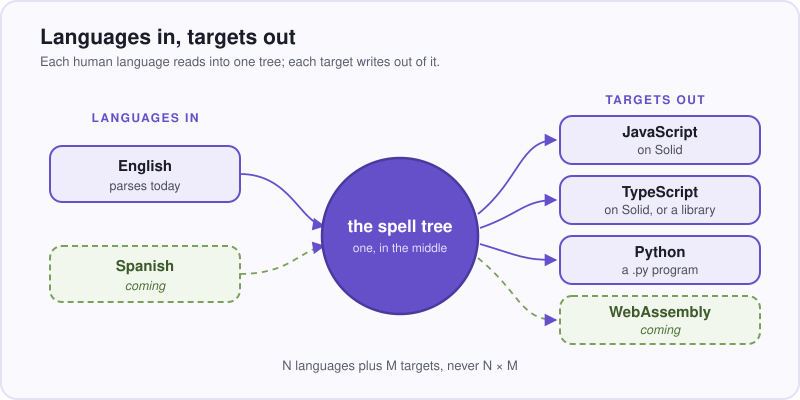
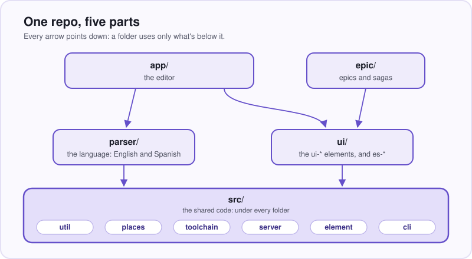

# Spell

**English you can run.**

```spell
a "card" is a view:
	- its "suit" is one of clubs, diamonds, hearts or spades
	- its "color" is:
		red if its suit is diamonds or hearts
		black otherwise

	- its "rank" is one of ace, 2 ... 10, jack, queen, king
	- it "is a face card" if its rank is jack, queen or king
	- it "is a (rank)"
	- it "is the (rank) of (suit)"
```

_Real Spell, in its outline style.  It compiles as written, to JavaScript, TypeScript or Python._

You just read a program.
Nobody taught you its syntax, and you could explain it to a friend.

That isn't pseudo-code, and it isn't a prompt.
A rule-based parser reads it the same way every time:  no model guessing what you meant.

Spell is that language, and the environment around it:
an editor that runs your program as you type, a command line, a library of web components,
and the tooling that lets people and coding agents build it all together.

- **People who don't program** can read, change and make real software, in plain English.
- **An AI writes Spell, and you can read what it wrote.**  Checking and changing it is how you learn to write your
  own.  That's the direction;  the language and the editor are here today.
- **Many languages, many targets.**  English and Spanish in;  JavaScript, TypeScript and Python out.



_A Spanish program is a Spanish file, `Carta.es.spell`, and it compiles to the same targets._

## Spaces:  where projects and people live

```text
@spell/examples/Solitaire/Solitaire.spellml
└──── group ──┘ └project─┘ └──── file ──┘
```

Every project and every file in Spell has an address like that one.
It's the same address in the editor, on the command line, and in the project that imports it.

A space is a person's or an organization's folder of projects:
`@spell` is Spell's own, and `owen@spell` is a person's, at Spell.

If you know npm, `@spell/library/people` reads like a scoped package, `@org/name`, and it's meant to:
whose it is, then what.
The difference is that there's no registry and no install:
the address alone says which folder holds the project, so a library on your disk is importable the moment it exists.

## One repo, five parts

[spell-app/spell](https://github.com/spell-app/spell) is one clone and one install, and every part of Spell is a folder in it.



_Every arrow points down:  a folder uses only what's below it._

| Folder | What it is |
| --- | --- |
| [src/](https://github.com/spell-app/spell#the-shared-code-under-src) | The shared code under everything:  helpers, where data lives (`places`, Spell's word for a back-end), the toolchain, the page server, the element framework, the command line. |
| [parser/](https://github.com/spell-app/spell/blob/main/parser/README.md) | The language:  a rule-based parser that knows no language, Spell's rules written in Rulex (regular expressions for words), the runtime, and a writer per target. |
| [ui/](https://github.com/spell-app/spell/blob/main/ui/README.md) | Spell UI:  accessible, themeable web components that load themselves on demand, for plain HTML or any framework. |
| [epic/](https://github.com/spell-app/spell/blob/main/epic/README.md) | Epics and sagas:  build software with a coding agent where the plan is a living page you review while it works.  A Claude Code plugin. |
| [app/](https://github.com/spell-app/spell/blob/main/app/README.md) | The editor:  a live programming environment that runs your program beside the text as you type;  spaces for projects and people;  the language server and the VS Code extension. |

## Where to go next

- **Set up from zero:**  [the README](https://github.com/spell-app/spell#setup-from-zero), for someone new to Node.
- **Try the language in two minutes:**  [the parser's README](https://github.com/spell-app/spell/blob/main/parser/README.md#try-it-in-two-minutes).
- **See the editor:**  [the app's README](https://github.com/spell-app/spell/blob/main/app/README.md).
- **Set up your own space:**  [Spaces](https://github.com/spell-app/spell/blob/main/app/README-spaces.md).
- **Say where a program's data lives:**  [Where data lives](https://github.com/spell-app/spell/blob/main/parser/README-spell.md#where-data-lives).
- **Drop a component on a page:**  [Spell UI's README](https://github.com/spell-app/spell/blob/main/ui/README.md).
- **Every command:**  [the command line](https://github.com/spell-app/spell/blob/main/README/cli.md).
- **Working on Spell, with or without an agent:**
  [development](https://github.com/spell-app/spell/blob/main/README/development.md) and
  [agents](https://github.com/spell-app/spell/blob/main/README/agents.md).

## 🌱 Coming

The first release, planned for December 1, 2026 (until then, `npm install spell@next`) · more human languages ·
more targets · build a program by moving things around, not only by typing · a public website for Spell, its docs and
its components.

Every README says what runs today and what's coming;  nothing is shown as working that you can't run.
