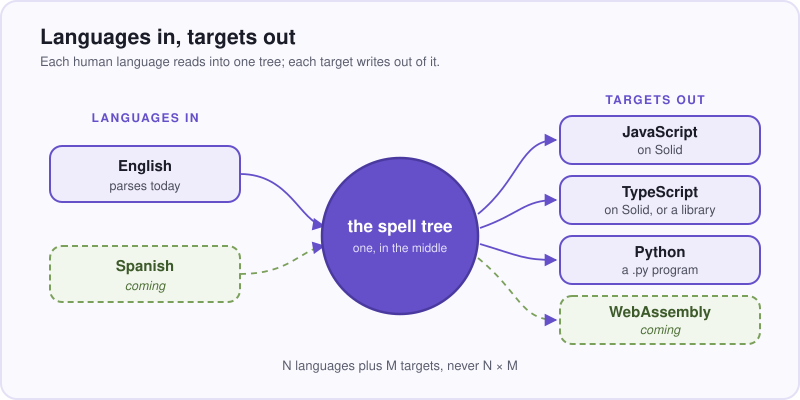
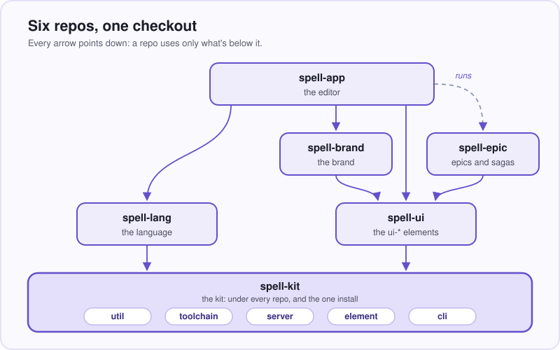

# Spell

**English you can run.**

Spell is a programming language written in plain English, and the environment around it:  an editor that runs
your program as you type, a command line, a library of web components, and the tooling that lets people and
coding agents build it all together.

```spell
a card is a thing:
  - its "suit" is one of clubs, diamonds, hearts or spades
  - its "color" is red if:
      its suit is either diamonds or hearts
      otherwise it is black
```

_Real spell, from the Solitaire example.  It compiles to JavaScript, TypeScript or Python._

- **People who don't program** can read, change and make real software, in plain English.
- **An AI writes spell, and you can read what it wrote.**  Checking and changing it is how you learn to write your
  own.  That's the direction;  the language and the editor are here today.
- **One language, many targets.**  English in;  JavaScript, TypeScript and Python out.



## The repos

Six git repos, one npm package each.  The kit comes first;  the other five are cloned inside it and share one
install.



_Every arrow points down:  a repo uses only what's below it._

| Repo | What it is |
| --- | --- |
| [spell-kit](https://github.com/spell-app/spell-kit) | **Start here.**  The root everything is cloned into:  setup from zero, the command line, the page server, the element framework, the house style for agents.  Its README is the map of every other README. |
| [spell-lang](https://github.com/spell-app/spell-lang) | The language:  a rule-based parser that knows no language, spell's rules written in Rulex (regular expressions for words), the runtime, and a writer per target. |
| [spell-app](https://github.com/spell-app/spell-app) | The editor:  a live programming environment that runs your program beside the text as you type;  spaces for projects and people;  the language server and the VS Code extension. |
| [spell-ui](https://github.com/spell-app/spell-ui) | Spell UI:  accessible, themeable web components that load themselves on demand, for plain HTML or any framework. |
| [spell-epic](https://github.com/spell-app/spell-epic) | Epics and sagas:  build software with a coding agent where the plan is a living page you review while it works.  A Claude Code plugin. |
| [spell-brand](https://github.com/spell-app/spell-brand) | The brand:  Spell's theme, the `<brand-*>` elements and the assets.  Being reworked. |

## Where to go next

- **Set up from zero:**  [the kit's README](https://github.com/spell-app/spell-kit#setup-from-zero), six steps for a
  Node novice.
- **Try the language in two minutes:**  [spell-lang's README](https://github.com/spell-app/spell-lang#try-it-in-two-minutes).
- **See the editor:**  [spell-app's README](https://github.com/spell-app/spell-app).
- **Drop a component on a page:**  [spell-ui's README](https://github.com/spell-app/spell-ui).
- **Every command:**  [README-cli](https://github.com/spell-app/spell-kit/blob/main/README-cli.md), in the kit.
- **Working on Spell, with or without an agent:**
  [README-development](https://github.com/spell-app/spell-kit/blob/main/README-development.md) and
  [README-agents](https://github.com/spell-app/spell-kit/blob/main/README-agents.md).

## Coming

🌱 Spell in other human languages (Spanish first) · a WebAssembly target · build a program by dragging things
around · several people in one program at once · an agent that rewrites your React or Python as spell so you
can read it.

Every README says what runs today and what's coming;  nothing is shown as working that you can't run.
